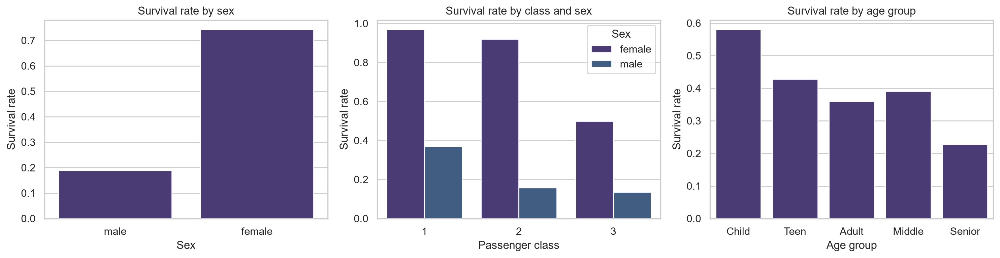
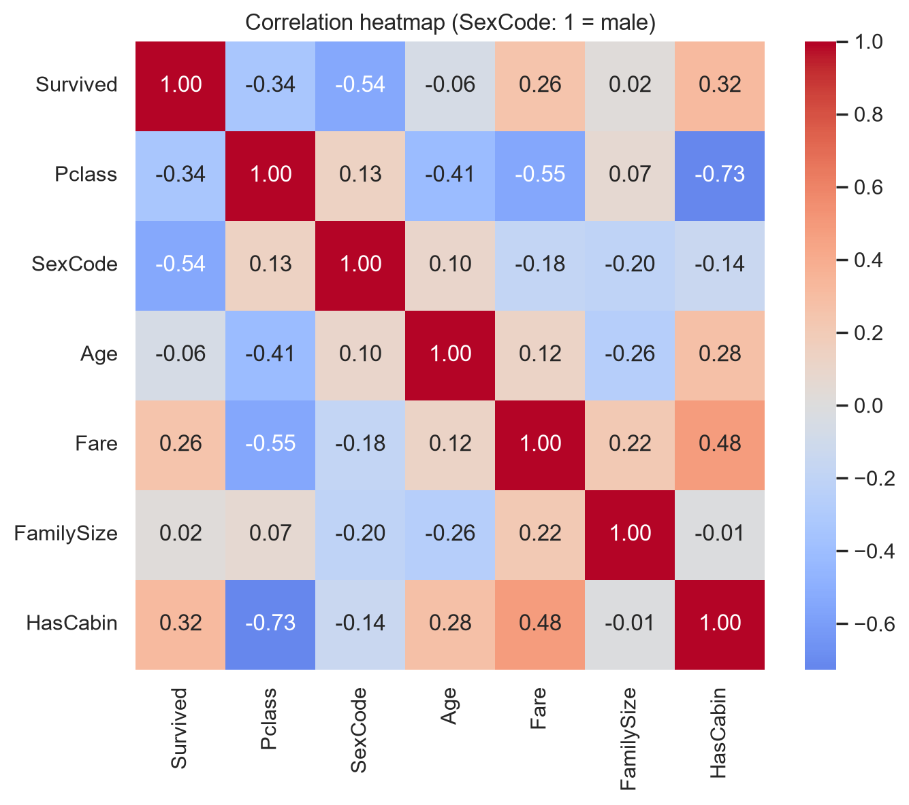
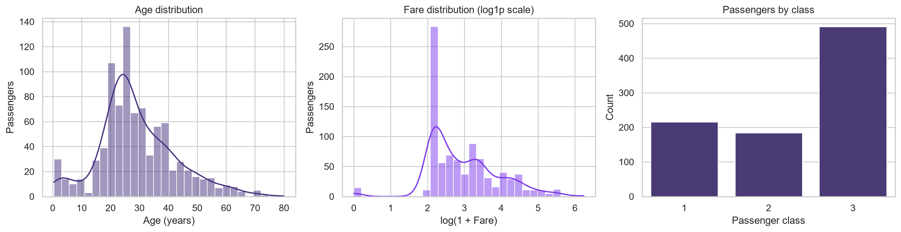
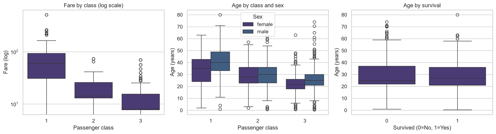
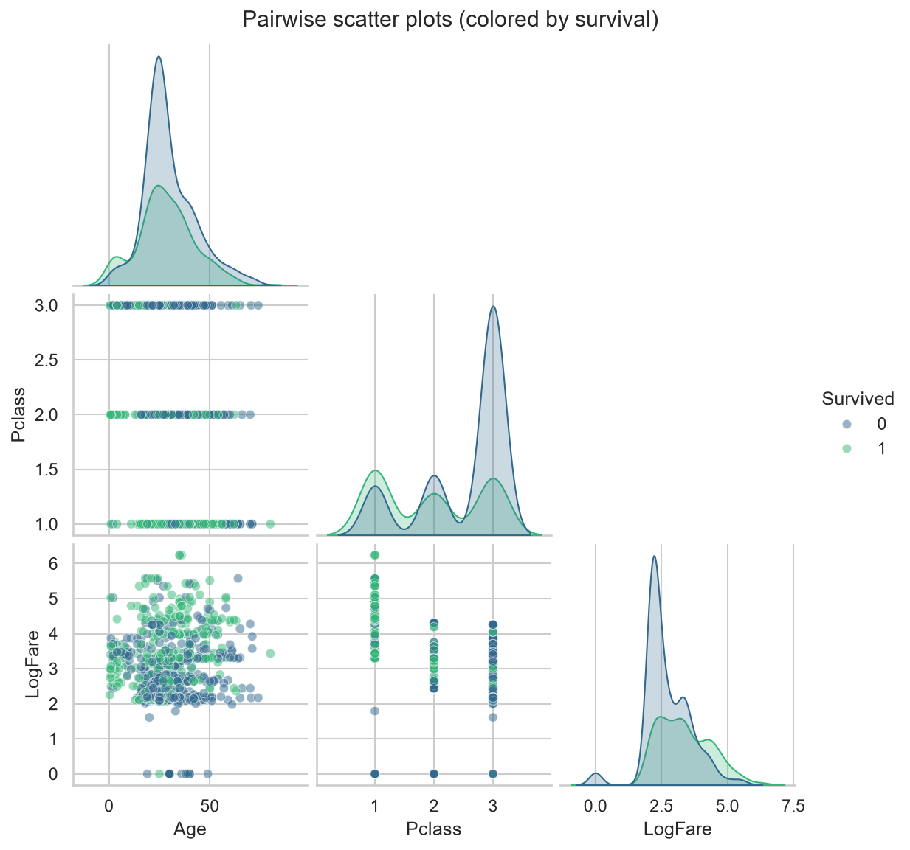

Task 1 - Exploratory Data Analysis (Titanic)

CodeNova AI/ML Internship, Batch 01.

**Dataset:** Titanic passengers (891 rows, public CSV in `data/`).
**Notebook:** `eda.ipynb` is fully executed, with markdown commentary under every visualization. High-resolution images are in `figures/`.

## Cleaning decisions
| Column | Issue | Treatment | Why |
|---|---|---|---|
| Cabin | 77% missing | Dropped, kept `HasCabin` flag | Imputing most of a column invents data; missingness itself is informative |
| Age | 20% missing | Median by (Pclass, Sex) | Skewed variable; group medians keep class/sex structure |
| Embarked | 2 missing | Mode | 0.2% missing, negligible impact |
| Fare | 13% IQR outliers | Kept, log scale for plots | Outliers are genuine first-class fares |

Survival rates by sex, class and age group Survival rates

## Screenshots / Results
**Survival rates by sex, class and age group**


**Correlation heatmap**


**Feature distributions**


**Boxplots**


**Pairwise scatter plots**


## Run
```bash
pip install -r requirements.txt
jupyter notebook eda.ipynb
